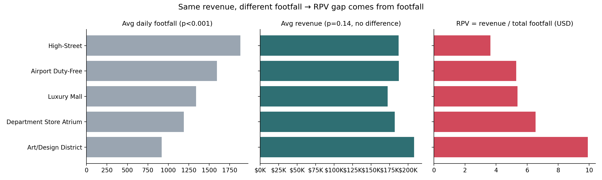
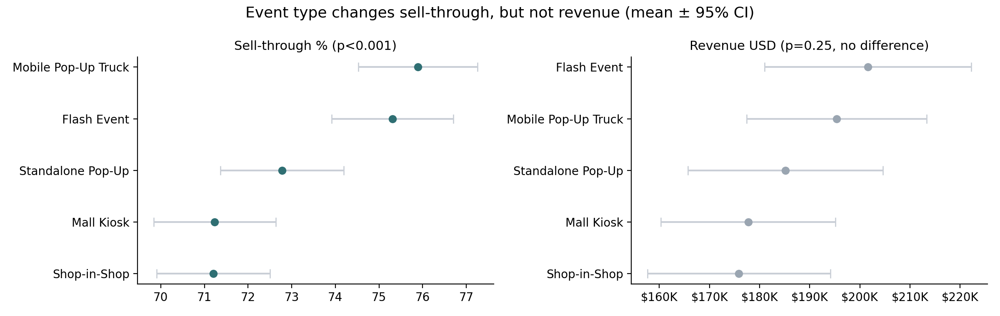
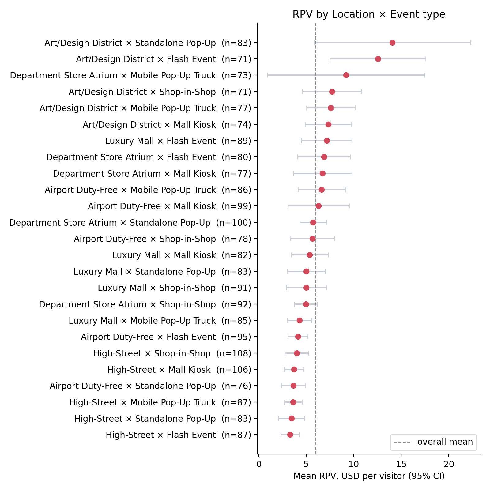

# Examining Pop-Up Revenue Drivers through Regression and ANOVA in Python

Do high-traffic locations really bring in more revenue for beauty pop-up stores?
Using 2,133 pop-up events, this project found that **revenue depended on product price, not on location or foot traffic**.

- **Tools:** Python (pandas, SciPy, statsmodels, matplotlib), Tableau
- **Methods:** correlation, one- and two-way ANOVA, multiple regression, 95% confidence intervals
- **Portfolio page:** [link]
- **Tableau dashboard:** [link]

---

## 1. Goal

As K-beauty brands open more pop-up stores, choosing where to open them has become a key decision, and busy locations usually come with higher rent. This project asked:

1. Do locations with more foot traffic bring in more revenue, or more revenue per visitor?
2. Does the type of event (for example, a flash event or a mall kiosk) change sales results?
3. Once other factors are held constant, what drives revenue?

## 2. Data

- **Source:** [Luxury Beauty Cosmetics Pop-Up Events KPI 2025](https://www.kaggle.com/datasets/pratyushpuri/luxury-beauty-cosmetics-popup-events-kpi-2025) (Kaggle). License: [check on Kaggle]
- **Size:** 2,133 events, 15 columns (2024–2025)
- **Main columns:** brand, region, city, location type, event type, start and end dates, lease length (days), product name, price, average daily footfall, units sold, sell-through rate

The raw file is not included. Download `PopUp_Events_KPI_2025.csv` from Kaggle and place it in `data/raw/`.

## 3. Preprocessing

[`preprocessing.ipynb`](preprocessing.ipynb) creates `data/popup_events_clean.csv`.

| Step | What it does |
|---|---|
| 1. Column names | Lowercased and stripped spaces |
| 2. Dates | Converted `start_date` and `end_date` to dates |
| 3. Revenue | `revenue_usd` = units_sold × price_usd (the raw data has no revenue column) |
| 4. Country | Mapped `city` to `country`. 47 rows have no city, so their country is also missing. These columns are not used in the analysis, which uses `region` (no missing values). |
| 5. End date | Filled 36 missing `end_date` values with start_date + lease_length_days |
| 6. Category | Assigned one of 10 product categories by finding the category name in `product_name` (e.g., "Glow **Mascara**" → Mascara). Every product matched a category. |

Step 5 shows that `lease_length_days` equals the event duration, which is why total footfall is calculated as average daily footfall × lease days (see RPV below).

## 4. Analysis

[`popup_analysis_basic.py`](popup_analysis_basic.py) runs all tests and saves the figures.

**Derived variables (in the analysis script)**
- **RPV (revenue per visitor)** = revenue ÷ (average daily footfall × lease days). It counts everyone who visited, not only buyers.
- **Season** from the start month (used as a control variable in the regression).

| Step | Method | Question |
|---|---|---|
| 1 | Pearson correlation | Does revenue rise with footfall? |
| 2 | One-way ANOVA | Do footfall, revenue, RPV and sell-through differ by location or event type? |
| 3 | Two-way ANOVA | Do some location × event type combinations have a special effect? |
| 4 | Multiple regression | Holding other variables fixed, what drives revenue? |
| 5 | 95% confidence intervals | Can the RPV ranking of combinations be trusted? |

In ANOVA and regression, p < 0.05 means a difference is unlikely to be due to chance.

## 5. Results

| Question | Result |
|---|---|
| Does revenue rise with footfall? | No (r = −0.024, p = 0.272) |
| Does footfall differ by location? | Yes (p < 0.001) |
| Does revenue differ by location? | No (p = 0.142) |
| Does RPV differ by location? | Yes (p < 0.001) |
| Does sell-through differ by event type? | Yes (p < 0.001) |
| Does revenue differ by event type? | No (p = 0.247) |
| Do location × event combinations matter? | No (interaction p = 0.097) |

### Traffic did not bring revenue

High-Street drew **2.04 times** the footfall of Art/Design District (1,880 vs. 920 visitors per day) but earned about 10% less ($187,232 vs. $208,104). Since revenue did not differ by location, the RPV gap ($3.63 vs. $9.92) came from footfall alone.



### Price drove revenue

- Price had a strong correlation with revenue (r = 0.726).
- Price alone explained **53%** of revenue (R² = 0.527). Adding footfall, lease length, event type, location, brand, category, region and season raised this only to 53.6%.
- In the regression, footfall was not significant (p = 0.051).

Note: revenue is price × units sold, so part of price's effect is built into the revenue column.

### Event type changed sell-through, not revenue

Flash events (75.3%) and mobile trucks (75.9%) sold more of their stock than mall kiosks and shop-in-shops (71.2%). Flash events beat mall kiosks by **4.1 percentage points**. Revenue did not differ by event type (p = 0.247), and units sold stayed within a narrow range (1,840–2,038).



### No combination was clearly the best

The location × event type interaction was not significant (p = 0.097). The top combination had a mean RPV of $14.06, but its 95% confidence interval was wide ($5.82–$22.31) and overlapped with other combinations, so its first place cannot be trusted.



## 6. From Analysis to Decision

- **Choose locations by cost, not traffic.** Revenue did not differ by location, so lower-rent sites deserve a look before busy ones.
- **Hit revenue targets through the product mix** (for example, the share of fragrances and serums) rather than through a prime location.
- **Match the event type to inventory goals.** Flash events and mobile trucks suit selling out limited stock.

**Limitations**
- Revenue is price × units, so price's role is partly built in.
- The data may be synthetic; the dataset page does not say how it was collected.
- Rent costs were not available, so profit could not be compared.

## 7. How to run

```bash
pip install -r requirements.txt
# 1) Put PopUp_Events_KPI_2025.csv in data/raw/
# 2) Run preprocessing.ipynb   -> data/popup_events_clean.csv
# 3) Run the analysis          -> figures/*.png
python popup_analysis_basic.py
```

## Repository structure

```
├── README.md
├── preprocessing.ipynb        # raw data -> data/popup_events_clean.csv
├── popup_analysis_basic.py    # statistical tests and figures
├── requirements.txt
├── data/
│   ├── raw/                   # Kaggle file goes here (not included)
│   └── popup_events_clean.csv
└── figures/
    ├── fig1_location_footfall_revenue.png
    ├── fig2_event_type.png
    └── fig3_combo_rpv_ci.png
```
